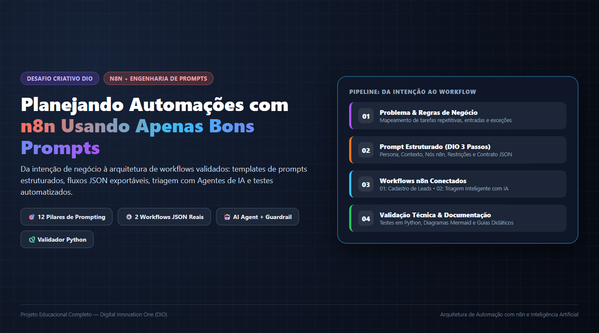
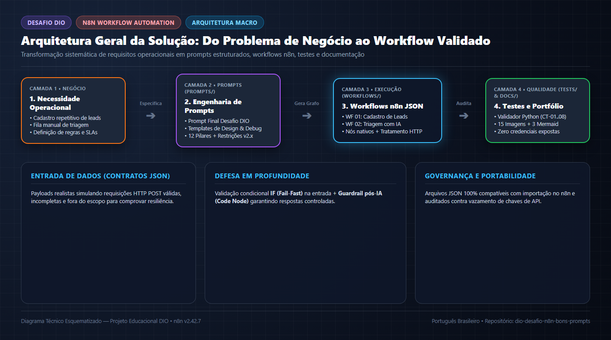
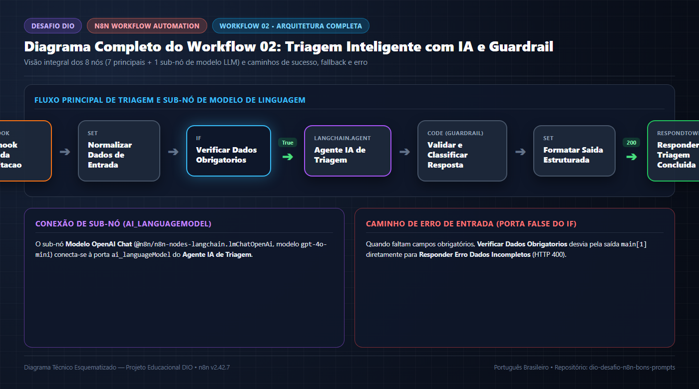

# 🚀 Desafio DIO — Planejando Automações com n8n Usando Bons Prompts



> **Entrega Principal do Desafio DIO:** Acesse diretamente o prompt completo, autossuficiente e pronto para copiar em **[`prompts/prompt-final-desafio-dio.md`](prompts/prompt-final-desafio-dio.md)**.

---

## 📑 Sumário de Navegação

1. [Banner e Apresentação do Desafio](#-1-apresentação-do-desafio)
2. [Objetivo Geral e Objetivos Específicos](#-2-objetivo-geral-e-objetivos-específicos)
3. [Problema que o Projeto Resolve](#-3-problema-que-o-projeto-resolve)
4. [Conceitos de Engenharia de Prompts Aplicados](#-4-conceitos-de-engenharia-de-prompts-aplicados)
5. [Visão Geral da Solução](#-5-visão-geral-da-solução)
6. [Arquitetura do Projeto](#-6-arquitetura-do-projeto)
7. [Links para a Documentação Técnica (`docs/`)](#-7-documentação-técnica-completa)
8. [Link Direto para o Prompt Final da DIO (`prompts/`)](#-8-prompt-final-e-biblioteca-de-prompts)
9. [Workflows Demonstrativos n8n (`workflows/`)](#-9-workflows-demonstrativos-no-n8n)
10. [Galeria de Diagramas e Imagens Didáticas (`assets/`)](#-10-galeria-de-diagramas-e-imagens-didáticas)
11. [Tecnologias e Ferramentas Utilizadas](#-11-tecnologias-e-ferramentas-utilizadas)
12. [Instruções para Importar os Workflows no n8n](#-12-instruções-para-importar-os-workflows-no-n8n)
13. [Pré-requisitos e Configurações Necessárias](#-13-pré-requisitos-e-configurações-necessárias)
14. [Como Executar os Testes e Validações (`tests/`)](#-14-como-executar-os-testes-e-validações)
15. [Limitações Conhecidas e Transparência Técnica](#-15-limitações-conhecidas-e-transparência-técnica)
16. [Fontes Oficiais de Referência](#-16-fontes-oficiais-de-referência)
17. [Conclusão e Aprendizados](#-17-conclusão-e-aprendizados)
18. [Licença](#-18-licença)
19. [Entrega Oficial do Desafio DIO (Repositório GitHub)](#-19-entrega-oficial-do-desafio-dio)

---

## 📌 1. Apresentação do Desafio

Este repositório contém o projeto educacional e técnico desenvolvido para o desafio da **DIO (Digital Innovation One)**:

**Desafio Criativo: Planejando Automações com n8n Usando Apenas Bons Prompts**

Mais do que apresentar um único prompt isolado, este projeto demonstra na prática todo o ciclo de engenharia de automação assistida por Inteligência Artificial: identificamos tarefas repetitivas reais, estruturamos prompts reutilizáveis de alta precisão, traduzimos esses prompts em **dois workflows JSON compatíveis com o n8n**, documentamos visualmente cada nó com diagramas e lâminas didáticas e validamos toda a estrutura com testes automatizados em Python.

---

## 🎯 2. Objetivo Geral e Objetivos Específicos

### Objetivo Geral
Transformar necessidades operacionais de negócio em **prompts estruturados, claros e reutilizáveis** capazes de orientar a construção de workflows resilientes no **n8n**, acompanhados de validação técnica, documentação visual para iniciantes e versionamento profissional no GitHub.

### Objetivos Específicos
- **Identificar processos repetitivos** de alto impacto operacional (Cadastro de Leads e Triagem de Atendimento).
- **Definir o público beneficiado**, os contratos de dados de entrada/saída e o resultado esperado de cada automação.
- **Organizar etapas, regras de negócio, validações e caminhos de exceção** antes da implementação.
- **Construir uma biblioteca de prompts** (incluindo o [Prompt Final da DIO](prompts/prompt-final-desafio-dio.md)) com restrições contra alucinações e sintaxes legadas.
- **Desenvolver dois workflows JSON válidos** (`01-cadastro-de-leads` e `02-triagem-inteligente-ia`) prontos para importação no n8n.
- **Explicar visualmente cada nó e cada etapa** por meio de 15 imagens PNG didáticas e 3 diagramas Mermaid.
- **Executar validações estáticas e lógicas automatizadas** via script Python (`tests/validar-workflows.py`).

---

## ❓ 3. Problema que o Projeto Resolve

O projeto ataca duas dores reais e complementares:

1. **No Processo de Negócio (Operações Comerciais e Atendimento):**
   - **Cadastro Manual de Leads:** Formulários web enviam nomes com espaços extras, e-mails em letras maiúsculas ou inválidos e campos opcionais vazios. Sem validação e higienização automáticas, dados corrompidos chegam ao time comercial e atrasam o primeiro contato.
   - **Triagem Manual de Chamados:** Solicitações de suporte técnico crítico, dúvidas financeiras, pedidos de orçamento comercial e mensagens fora de escopo caem na mesma fila, gerando gargalos de priorização.

2. **Na Engenharia de Automação Assistida por IA:**
   - Prompts vagos (ex.: *"Crie um fluxo no n8n para leads"*) fazem com que modelos de linguagem gerem fluxos sem tratamento de erro, inventem parâmetros inexistentes ou utilizem sintaxes depreciadas da versão 0.x do n8n (`$node[...]`).

---

## 🧠 4. Conceitos de Engenharia de Prompts Aplicados

Toda a biblioteca de prompts deste projeto foi construída sobre **12 pilares de especificação técnica** (detalhados em [`docs/03-engenharia-de-prompts.md`](docs/03-engenharia-de-prompts.md)):

| Pilar | Aplicação Prática neste Projeto |
| :--- | :--- |
| **1. Papel da IA (Persona)** | Engenheiro de Software Sênior e Arquiteto especialista em n8n (v1.x / v2.x). |
| **2. Contexto & 3. Objetivo** | Delimitação clara da dor operacional e do resultado síncrono esperado via Webhook. |
| **4. Público-Alvo** | Linguagem técnica acessível em português brasileiro voltada a estudantes e desenvolvedores. |
| **5. Ferramentas & 6. Sequência** | Seleção estrita de nós nativos (`Webhook`, `IF`, `Edit Fields / Set`, `AI Agent`, `Code`, `Respond to Webhook`). |
| **7. Regras & 8. Restrições** | Obrigatoriedade de campos, normalização `.trim().toLowerCase()`, proibição de `$node[...]` e zero credenciais reais no JSON. |
| **9. Tratamento de Erros** | Uso do ramo `False` do nó `IF` para retornar `HTTP 400` e *Guardrail* em código pós-IA com fallback determinístico. |
| **10. Formato & 11. Validação** | Exigência de diagramas Mermaid, tabelas nó a nó, payloads de teste e verificação com `validar-workflows.py`. |

---

## 💡 5. Visão Geral da Solução

A solução entrega um ecossistema educacional completo dividido em quatro frentes:
1. **Prompt Final e Templates (`prompts/`):** O [Prompt Final do Desafio DIO](prompts/prompt-final-desafio-dio.md) estruturado nos 3 passos oficiais + 3 templates parametrizáveis (Conteúdo, Design de Workflow e Troubleshooting).
2. **Workflow 01 — Cadastro Automatizado de Leads (`workflows/01-cadastro-de-leads/`):** Pipeline determinístico que recebe leads via Webhook, valida `nome` e `email`, higieniza dados e retorna resposta comercial demonstrativa (`HTTP 200` ou `HTTP 400`).
3. **Workflow 02 — Triagem Inteligente com IA (`workflows/02-triagem-inteligente-ia/`):** Pipeline híbrido que normaliza solicitações, valida dados obrigatórios, classifica com `AI Agent` (`Comercial`, `Suporte técnico`, `Financeiro`, `Outros`), audita a saída com *Guardrail* e possui fallback determinístico local.
4. **Suíte de Qualidade e Documentação Visual (`docs/`, `assets/`, `tests/`):** 8 capítulos técnicos, 15 imagens PNG, 3 diagramas Mermaid e validador automatizado em Python.

---

## 🏗️ 6. Arquitetura do Projeto



> 📄 **Diagrama Mermaid correspondente:** [`assets/diagrams/arquitetura-geral.mmd`](assets/diagrams/arquitetura-geral.mmd)

```text
dio-desafio-n8n-bons-prompts/
├── README.md                                  # Página inicial do projeto
├── LICENSE                                    # Licença MIT
├── .gitignore                                 # Proteção contra envio de segredos e temporários
├── .gitattributes                             # Padronização de finais de linha (LF) e binários
├── docs/                                      # 8 capítulos de documentação técnica e índice
├── prompts/                                   # Prompt Final da DIO + 3 templates reutilizáveis
├── workflows/                                 # 2 workflows n8n em JSON + payloads de exemplo
├── assets/                                    # 15 imagens PNG didáticas + 3 diagramas Mermaid (.mmd)
└── tests/                                     # Validador Python (validar-workflows.py) + casos de teste
```

---

## 📚 7. Documentação Técnica Completa

Acesse o índice em [`docs/README.md`](docs/README.md) ou navegue diretamente pelos 8 capítulos:

1. **[01 — Contexto e Objetivos](docs/01-contexto-e-objetivos.md):** Escopo, público-alvo, entregáveis e diferenciação entre o requisito básico da DIO e as extensões implementadas.
2. **[02 — Curadoria de Fontes](docs/02-curadoria-de-fontes.md):** Fontes primárias oficiais verificadas (`docs.n8n.io`, `docs.github.com`, `github.com/n8n-io/n8n`) com datas de acesso e finalidades.
3. **[03 — Engenharia de Prompts](docs/03-engenharia-de-prompts.md):** Os 12 pilares, comparativo *Antes vs. Depois* e tabela de problemas ("cicatrizes"), causas e melhorias.
4. **[04 — Miniestudo Final](docs/04-miniestudo-final.md):** Estudo completo *"Da intenção ao workflow: como transformar bons prompts em automações n8n"*.
5. **[05 — Glossário Técnico](docs/05-glossario.md):** Tabela com 22 termos essenciais definidos, exemplificados e contextualizados no projeto.
6. **[06 — Arquitetura da Solução](docs/06-arquitetura-da-solucao.md):** Fluxo de dados, contratos JSON, barreiras de validação e diagramas Mermaid.
7. **[07 — Validação e Testes](docs/07-validacao-e-testes.md):** Matriz de testes executados (`CT-01` a `CT-08`) e testes dependentes de runtime/credencial (`CT-09` e `CT-10`).
8. **[08 — Guia de Apresentação](docs/08-guia-de-apresentacao.md):** Roteiro estruturado (*pitch técnico*) para defender este projeto em entrevistas e avaliações.

---

## 🏆 8. Prompt Final e Biblioteca de Prompts

Catálogo completo em [`prompts/README.md`](prompts/README.md):

- 🌟 **[`prompts/prompt-final-desafio-dio.md`](prompts/prompt-final-desafio-dio.md) — ENTREGA PRINCIPAL DO DESAFIO DIO:** Prompt completo, autossuficiente e pronto para copiar, organizado nos 3 passos da DIO (Definir automação, Adicionar contexto/regras, Montar prompt final).
- [`prompts/prompt-design-workflow.md`](prompts/prompt-design-workflow.md) — Template arquitetural de 15 pontos para projetar workflows n8n.
- [`prompts/prompt-geracao-conteudo.md`](prompts/prompt-geracao-conteudo.md) — Template para gerar documentação técnica auditável de automações.
- [`prompts/prompt-troubleshooting.md`](prompts/prompt-troubleshooting.md) — Template para diagnóstico de falhas com protocolo de sanitização de segredos.

---

## ⚙️ 9. Workflows Demonstrativos no n8n

Guia de importação e segurança em [`workflows/README.md`](workflows/README.md):

| Workflow | Documentação Ilustrada | Arquivo Exportável n8n | Payloads de Exemplo |
| :--- | :--- | :--- | :--- |
| **01 — Cadastro Automatizado de Leads** | [`workflows/01-cadastro-de-leads/README.md`](workflows/01-cadastro-de-leads/README.md) | [`workflow.json`](workflows/01-cadastro-de-leads/workflow.json) | [`exemplo-payload.json`](workflows/01-cadastro-de-leads/exemplo-payload.json) |
| **02 — Triagem Inteligente com IA** | [`workflows/02-triagem-inteligente-ia/README.md`](workflows/02-triagem-inteligente-ia/README.md) | [`workflow.json`](workflows/02-triagem-inteligente-ia/workflow.json) | [`entrada-valida.json`](workflows/02-triagem-inteligente-ia/exemplos/entrada-valida.json)<br/>[`entrada-incompleta.json`](workflows/02-triagem-inteligente-ia/exemplos/entrada-incompleta.json)<br/>[`entrada-fora-do-escopo.json`](workflows/02-triagem-inteligente-ia/exemplos/entrada-fora-do-escopo.json) |

---

## 🖼️ 10. Galeria de Diagramas e Imagens Didáticas

Consulte o catálogo visual em [`assets/README.md`](assets/README.md) e [`assets/img/README.md`](assets/img/README.md).

### Fluxos Completos dos Workflows
| Workflow 01 — Cadastro Automatizado de Leads | Workflow 02 — Triagem Inteligente com IA |
| :---: | :---: |
|  |  |
| [Ver todas as 6 lâminas passo a passo do Workflow 01](workflows/01-cadastro-de-leads/README.md) | [Ver todas as 7 lâminas passo a passo do Workflow 02](workflows/02-triagem-inteligente-ia/README.md) |

### Código-Fonte dos Diagramas Mermaid (`assets/diagrams/`)
- [`assets/diagrams/arquitetura-geral.mmd`](assets/diagrams/arquitetura-geral.mmd)
- [`assets/diagrams/fluxo-cadastro-leads.mmd`](assets/diagrams/fluxo-cadastro-leads.mmd)
- [`assets/diagrams/fluxo-triagem-ia.mmd`](assets/diagrams/fluxo-triagem-ia.mmd)

---

## 🛠️ 11. Tecnologias e Ferramentas Utilizadas

- **n8n (`v2.42.7` verificado no ambiente):** Plataforma de orquestração de workflows baseada em nós visuais e pacotes `n8n-nodes-base` / `@n8n/n8n-nodes-langchain`.
- **Engenharia de Prompts & LLMs:** Estruturação de instruções para arquitetura de automações e configuração do nó `AI Agent` com `OpenAI Chat Model` (`gpt-4o-mini`).
- **Python (`v3.15.0`):** Desenvolvimento e execução do validador estrutural, referencial, lógico e de segurança (`tests/validar-workflows.py`).
- **Markdown & Mermaid:** Documentação técnica rica e diagramas de fluxo baseados em texto.
- **Git & GitHub:** Controle de versão semântico e hospedagem pública do portfólio.

---

## 📥 12. Instruções para Importar os Workflows no n8n

1. Inicie sua instância do **n8n** (`n8n start` via CLI, Docker ou n8n Cloud) e acesse o editor no navegador.
2. Crie um novo workflow em branco.
3. Clique no menu superior direito **`⋮`** $\rightarrow$ **Import from File...**.
4. Escolha [`workflows/01-cadastro-de-leads/workflow.json`](workflows/01-cadastro-de-leads/workflow.json) ou [`workflows/02-triagem-inteligente-ia/workflow.json`](workflows/02-triagem-inteligente-ia/workflow.json).
5. Clique em **Test workflow** e envie os payloads JSON de exemplo via `POST` para a URL de teste exibida no nó `Webhook`.

---

## 🔐 13. Pré-requisitos e Configurações Necessárias

- **Para executar o validador automatizado:** Python `3.10+` instalado (utiliza apenas a biblioteca padrão).
- **Para importar e testar o Workflow 01 no n8n:** Apenas uma instância do n8n (`v1.x` ou `v2.x`). Nenhuma credencial externa é necessária.
- **Para testar o Workflow 02 no n8n:**
  - **Modo com IA em Nuvem:** Configure uma credencial do tipo `OpenAI API` no cofre do n8n e associe ao sub-nó `Modelo OpenAI Chat`.
  - **Modo Demonstrativo Local (Sem Credencial):** Nenhuma configuração adicional é necessária; o nó `Validar e Classificar Resposta` detecta automaticamente a ausência da API externa e utiliza a regra determinística de contingência.

---

## 🧪 14. Como Executar os Testes e Validações

Para validar todos os arquivos JSON, nós, conexões, ausência de segredos e regras lógicas de negócio, execute na raiz do repositório:

```powershell
python tests/validar-workflows.py
```

Saída obtida e verificada no ambiente:
```text
============================================================================
 VALIDADOR DE WORKFLOWS N8N — DESAFIO DIO BONS PROMPTS
============================================================================
[OK] Estrutura, nós, conexões e segurança validados: workflows/01-cadastro-de-leads/workflow.json (6 nós)
[OK] Estrutura, nós, conexões e segurança validados: workflows/02-triagem-inteligente-ia/workflow.json (9 nós)
[OK] Payload de exemplo válido e seguro: workflows/01-cadastro-de-leads/exemplo-payload.json
[OK] Payload de exemplo válido e seguro: workflows/02-triagem-inteligente-ia/exemplos/entrada-valida.json
[OK] Payload de exemplo válido e seguro: workflows/02-triagem-inteligente-ia/exemplos/entrada-incompleta.json
[OK] Payload de exemplo válido e seguro: workflows/02-triagem-inteligente-ia/exemplos/entrada-fora-do-escopo.json
[OK] Simulação lógica dos casos de teste (Positivos, Negativos e Fora do Escopo)
----------------------------------------------------------------------------
RESULTADO FINAL: SUCESSO — Todos os workflows e payloads passaram em 100% das verificações!
```

Consulte os detalhes em [`tests/README.md`](tests/README.md), [`tests/casos-de-teste.md`](tests/casos-de-teste.md) e [`docs/07-validacao-e-testes.md`](docs/07-validacao-e-testes.md).

---

## ⚠️ 15. Limitações Conhecidas e Transparência Técnica

1. **Saída Demonstrativa Sem Persistência Externa Forçada:** O Workflow 01 higieniza, valida e prepara os dados do lead, devolvendo o resultado via `Respond to Webhook` com `status_processamento: "registrado_demonstrativo"`. Não conectamos bancos de dados externos proprietários por padrão para garantir portabilidade imediata e zero dependência de credenciais.
2. **Separação entre Validação Estática e Execução em Servidor Ativo:** Todos os testes estruturais, de integridade de grafo, de segurança e de simulação lógica (`CT-01` a `CT-08`) foram efetivamente executados via Python. Os disparos HTTP contra o servidor web do n8n e a inferência ao vivo na OpenAI (`CT-09` e `CT-10`) dependem de o usuário iniciar o serviço e inserir sua própria chave de API.
3. **Zero Credenciais Versionadas:** Por política estrita de segurança, nenhuma chave de API ou token consta nos arquivos do repositório.

---

## 🔗 16. Fontes Oficiais de Referência

Todas as fontes foram verificadas em **24/10/2026** e estão catalogadas em [`docs/02-curadoria-de-fontes.md`](docs/02-curadoria-de-fontes.md):

- **n8n Official Documentation:** [https://docs.n8n.io/](https://docs.n8n.io/)
- **n8n Workflows & Core Concepts:** [https://docs.n8n.io/workflows/](https://docs.n8n.io/workflows/)
- **n8n Webhook Node Docs:** [https://docs.n8n.io/integrations/builtin/core-nodes/n8n-nodes-base.webhook/](https://docs.n8n.io/integrations/builtin/core-nodes/n8n-nodes-base.webhook/)
- **n8n Advanced AI & AI Agent Node Docs:** [https://docs.n8n.io/advanced-ai/](https://docs.n8n.io/advanced-ai/)
- **n8n Official GitHub Repository:** [https://github.com/n8n-io/n8n](https://github.com/n8n-io/n8n)
- **GitHub Official Documentation:** [https://docs.github.com/pt/repositories](https://docs.github.com/pt/repositories/creating-and-managing-repositories/about-repositories)

---

## 💡 17. Conclusão e Aprendizados

O desenvolvimento deste projeto comprova que **planejar automações com bons prompts é um exercício de arquitetura de software**. Quando substituímos pedidos genéricos por prompts estruturados — contendo contexto, regras de validação, tipos exatos de nós, restrições de versão e caminhos de exceção — conseguimos projetar workflows no **n8n** muito mais seguros, legíveis, testáveis e prontos para evoluir da prototipação para ambientes reais de produção.

---

## 📄 18. Licença

Este projeto é distribuído sob a licença **MIT**. Consulte o arquivo [`LICENSE`](LICENSE) para mais informações.

---

## 🏁 19. Entrega Oficial do Desafio DIO

- **Arquivo Principal da Entrega (Prompt Final DIO):** [`prompts/prompt-final-desafio-dio.md`](prompts/prompt-final-desafio-dio.md)
- **Repositório Público no GitHub:** [https://github.com/p-andrade/automacao-n8n](https://github.com/p-andrade/automacao-n8n)
- **Branch Principal Publicada:** `main`
