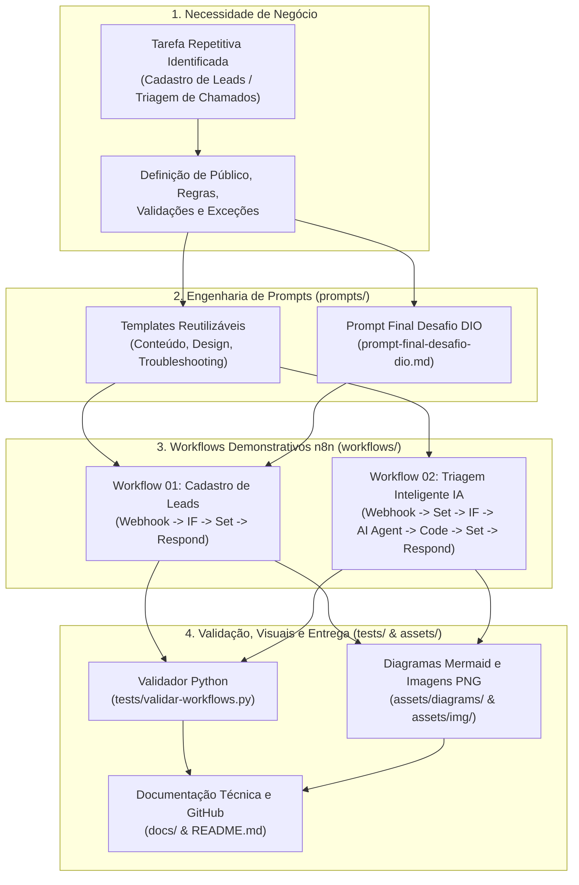
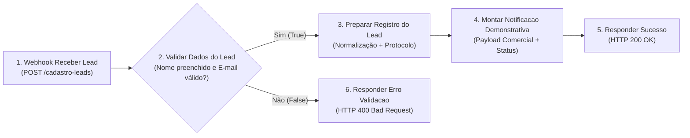
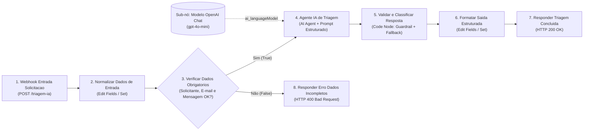

# 06. Arquitetura da Solução e Fluxo de Dados

> **Navegação:** [⬅️ 05. Glossário](./05-glossario.md) | [📚 Índice da Documentação](./README.md) | [Próximo: 07. Validação e Testes ➡️](./07-validacao-e-testes.md)

---

## 1. Visão Arquitetural Geral: Do Prompt ao Workflow Validado

A arquitetura deste projeto foi concebida em **quatro camadas integradas**:

1. **Camada de Intenção e Especificação (Engenharia de Prompts):** Onde o problema de negócio (cadastro manual de leads ou fila de triagem de atendimento) é transformado em requisitos formais, regras de negócio e restrições técnicas dentro da pasta [`prompts/`](../prompts/README.md).
2. **Camada de Orquestração e Processamento (Workflows n8n):** Onde os prompts estruturados são materializados em grafos executáveis (`workflow.json`) compostos por nós nativos do n8n nas pastas [`workflows/01-cadastro-de-leads/`](../workflows/01-cadastro-de-leads/README.md) e [`workflows/02-triagem-inteligente-ia/`](../workflows/02-triagem-inteligente-ia/README.md).
3. **Camada de Representação Visual Didática (Diagramas e Imagens):** Onde cada nó e cada transição de dados são espelhados em diagramas Mermaid (`assets/diagrams/`) e ilustrações técnicas passo a passo (`assets/img/`).
4. **Camada de Qualidade e Auditoria Automatizada (Testes):** Onde o validador estático [`tests/validar-workflows.py`](../tests/validar-workflows.py) e os casos de teste [`tests/casos-de-teste.md`](../tests/casos-de-teste.md) garantem que os JSONs exportáveis correspondem exatamente à arquitetura documentada e não expõem segredos.

### 1.1. Diagrama da Arquitetura Geral (Relação entre Prompt, Projeto e Workflow)

> 📄 **Arquivo fonte do diagrama:** [`assets/diagrams/arquitetura-geral.mmd`](../assets/diagrams/arquitetura-geral.mmd)  
> 🖼️ **Representação visual PNG:** [`assets/img/arquitetura-geral.png`](../assets/img/arquitetura-geral.png)



---

## 2. Arquitetura do Workflow 01 — Cadastro Automatizado de Leads

### 2.1. Componentes e Nós Sincronizados com `workflow.json`

O arquivo [`workflows/01-cadastro-de-leads/workflow.json`](../workflows/01-cadastro-de-leads/workflow.json) contém **6 nós** com nomes exatos em português brasileiro:

| Ordem | Nome Exato do Nó no JSON | Tipo (`type`) | Função Arquitetural |
| :---: | :--- | :--- | :--- |
| **01** | `Webhook Receber Lead` | `n8n-nodes-base.webhook` | Recebe requisições `POST /cadastro-leads` e aguarda o nó de resposta final (`responseMode: "responseNode"`). |
| **02** | `Validar Dados do Lead` | `n8n-nodes-base.if` | Ponto de validação principal: verifica se `nome` não está vazio e se `email` possui formato plausível (contém `@` e `.`). |
| **03** | `Preparar Registro do Lead` | `n8n-nodes-base.set` | Caminho de Sucesso (`true`): higieniza strings (`.trim()`, `.toLowerCase()`), preenche campos opcionais (`telefone`, `empresa`, `origem`) e gera `lead_id` e `criado_em`. |
| **04** | `Montar Notificacao Demonstrativa` | `n8n-nodes-base.set` | Empacota o objeto do lead preparado junto com a mensagem de notificação comercial demonstrativa e `status_processamento: "registrado_demonstrativo"`. |
| **05** | `Responder Sucesso` | `n8n-nodes-base.respondToWebhook` | Encerra a chamada HTTP no caminho feliz com status `200 OK` e o payload completo preparado. |
| **06** | `Responder Erro Validacao` | `n8n-nodes-base.respondToWebhook` | Caminho de Erro (`false` do nó `IF`): encerra a chamada HTTP imediatamente com status `400 Bad Request` e detalhes da falha de validação. |

### 2.2. Diagrama de Fluxo — Cadastro Automatizado de Leads

> 📄 **Arquivo fonte do diagrama:** [`assets/diagrams/fluxo-cadastro-leads.mmd`](../assets/diagrams/fluxo-cadastro-leads.mmd)



### 2.3. Contrato de Dados que Transitam pelo Workflow 01

- **Entrada no `Webhook Receber Lead`:**
  ```json
  {
    "nome": "  Mariana Costa  ",
    "email": "MARIANA.COSTA@empresa.com.br ",
    "telefone": "(11) 98765-4321",
    "empresa": "TechNova Soluções",
    "origem": "Landing Page Desafio DIO",
    "interesse": "Automação de Processos com n8n"
  }
  ```
- **Saída de Sucesso (`Responder Sucesso` — HTTP 200):**
  ```json
  {
    "status": "sucesso",
    "modo": "demonstrativo_sem_persistencia_externa",
    "lead": {
      "lead_id": "LEAD-DEMO-001",
      "nome": "Mariana Costa",
      "email": "mariana.costa@empresa.com.br",
      "telefone": "(11) 98765-4321",
      "empresa": "TechNova Soluções",
      "origem": "Landing Page Desafio DIO",
      "interesse": "Automação de Processos com n8n"
    },
    "notificacao_demonstrativa": {
      "canal_destino_sugerido": "#comercial-novos-leads",
      "mensagem": "Novo lead validado: Mariana Costa (TechNova Soluções) - mariana.costa@empresa.com.br"
    }
  }
  ```
- **Saída de Erro (`Responder Erro Validacao` — HTTP 400):**
  ```json
  {
    "status": "erro_validacao",
    "codigo_http": 400,
    "mensagem": "Payload inválido: os campos 'nome' e 'email' (em formato válido contendo '@' e '.') são obrigatórios.",
    "acao_recomendada": "Verifique os dados enviados no corpo da requisição JSON e tente novamente."
  }
  ```

---

## 3. Arquitetura do Workflow 02 — Triagem Inteligente com IA

### 3.1. Componentes e Nós Sincronizados com `workflow.json`

O arquivo [`workflows/02-triagem-inteligente-ia/workflow.json`](../workflows/02-triagem-inteligente-ia/workflow.json) contém **8 nós** (sendo 7 no fluxo principal e 1 sub-nó de modelo de linguagem conectado ao Agente):

| Ordem | Nome Exato do Nó no JSON | Tipo (`type`) | Função Arquitetural |
| :---: | :--- | :--- | :--- |
| **01** | `Webhook Entrada Solicitacao` | `n8n-nodes-base.webhook` | Recebe a solicitação via `POST /triagem-ia` com `responseMode: "responseNode"`. |
| **02** | `Normalizar Dados de Entrada` | `n8n-nodes-base.set` | Limpa espaços e padroniza `solicitante`, `email`, `assunto`, `mensagem` e `prioridade_informada`. |
| **03** | `Verificar Dados Obrigatorios` | `n8n-nodes-base.if` | Ponto de validação 1: exige `solicitante`, `email` com `@` e `mensagem` não vazia. |
| **04** | `Agente IA de Triagem` | `@n8n/n8n-nodes-langchain.agent` | Analisa a solicitação com prompt de sistema estrito pedindo JSON com `categoria`, `prioridade`, `resumo` e `justificativa`. Possui `continueOnFail: true`. |
| **04.1** | `Modelo OpenAI Chat` *(Sub-nó)* | `@n8n/n8n-nodes-langchain.lmChatOpenAi` | Sub-nó conectado via `ai_languageModel` ao `Agente IA de Triagem` (configurado para `gpt-4o-mini` com temperatura `0.1`). |
| **05** | `Validar e Classificar Resposta` | `n8n-nodes-base.code` | Ponto de validação 2 (*Guardrail pós-IA*): faz o parse seguro da saída da IA, valida se `categoria` $\in$ `{Comercial, Suporte técnico, Financeiro, Outros}` e `prioridade` $\in$ `{Alta, Média, Baixa}`, e executa classificação determinística de fallback caso o modelo falhe ou esteja sem credencial. |
| **06** | `Formatar Saida Estruturada` | `n8n-nodes-base.set` | Organiza o contrato final de saída com metadados de auditoria (`status_validacao`, `modo_execucao`). |
| **07** | `Responder Triagem Concluida` | `n8n-nodes-base.respondToWebhook` | Retorna HTTP `200 OK` com o resultado estruturado da triagem. |
| **08** | `Responder Erro Dados Incompletos` | `n8n-nodes-base.respondToWebhook` | Caminho de Erro (`false` do nó `IF`): retorna HTTP `400 Bad Request` quando faltam campos obrigatórios na entrada. |

### 3.2. Diagrama de Fluxo — Triagem Inteligente com IA

> 📄 **Arquivo fonte do diagrama:** [`assets/diagrams/fluxo-triagem-ia.mmd`](../assets/diagrams/fluxo-triagem-ia.mmd)



---

## 4. Pontos de Validação e Caminhos de Sucesso vs. Erro

A arquitetura implementa **Defesa em Profundidade** por meio de três barreiras de validação:

| Barreira | Localização | O que Valida | Comportamento em Caso de Sucesso | Comportamento em Caso de Erro / Exceção |
| :--- | :--- | :--- | :--- | :--- |
| **Barreira 1: Validação de Entrada (Lead)** | Nó `Validar Dados do Lead` (Workflow 01) | Presença de `nome` não vazio e `email` contendo `@` e `.`. | Avança pela saída `main[0]` para `Preparar Registro do Lead`. | Desvia pela saída `main[1]` para `Responder Erro Validacao` (HTTP 400). |
| **Barreira 2: Validação de Entrada (Triagem)** | Nó `Verificar Dados Obrigatorios` (Workflow 02) | Presença de `solicitante`, `email` válido e `mensagem` preenchida. | Avança pela saída `main[0]` para `Agente IA de Triagem`. | Desvia pela saída `main[1]` para `Responder Erro Dados Incompletos` (HTTP 400). |
| **Barreira 3: Validação Pós-IA (Guardrail de Esquema)** | Nó `Validar e Classificar Resposta` (Workflow 02) | Verifica se o JSON da IA é válido e se `categoria` e `prioridade` pertencem estritamente às listas permitidas. | Mantém a classificação da IA com `status_validacao: "validado_ia"`. | Se a IA retornar categoria inventada, JSON truncado ou erro por falta de credencial, higieniza e classifica via heurística segura com `status_validacao: "validado_fallback_regras"`, mantendo HTTP 200 estruturado. |
