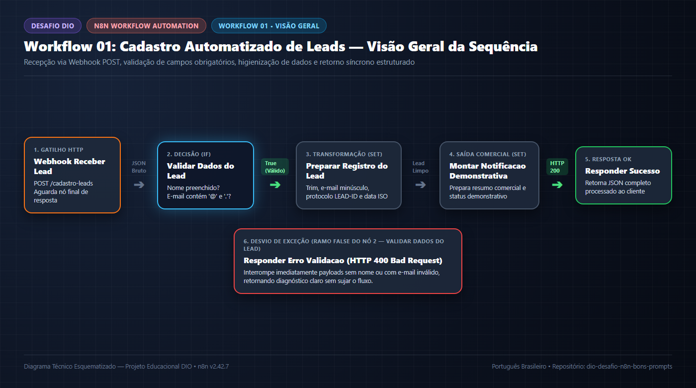
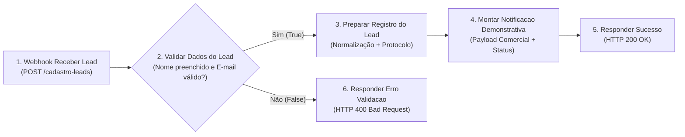
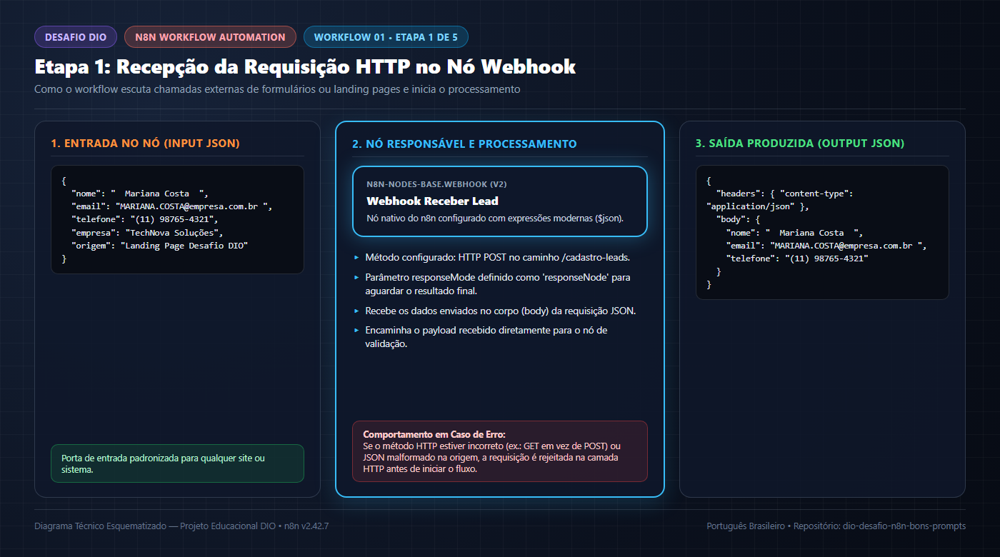
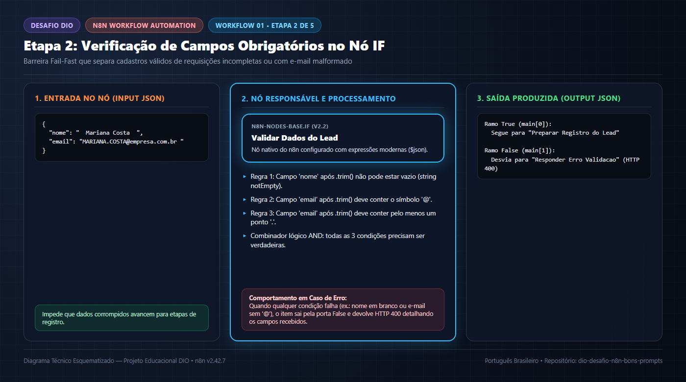
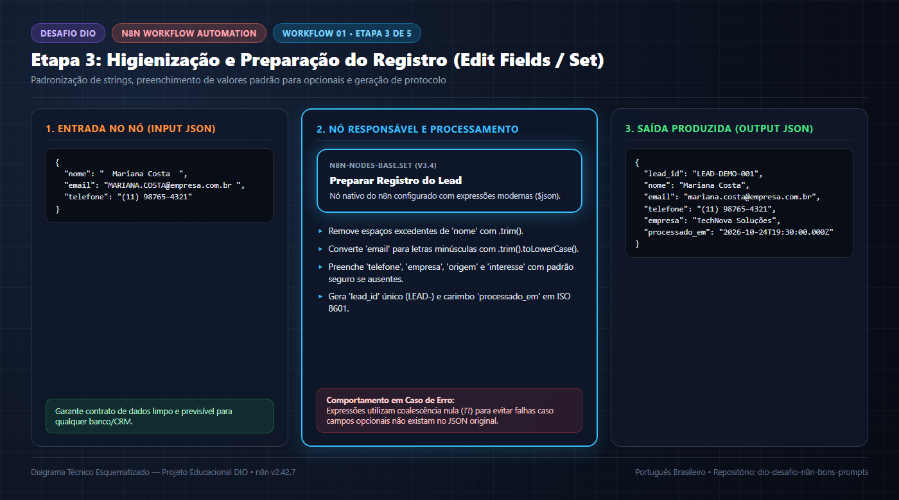
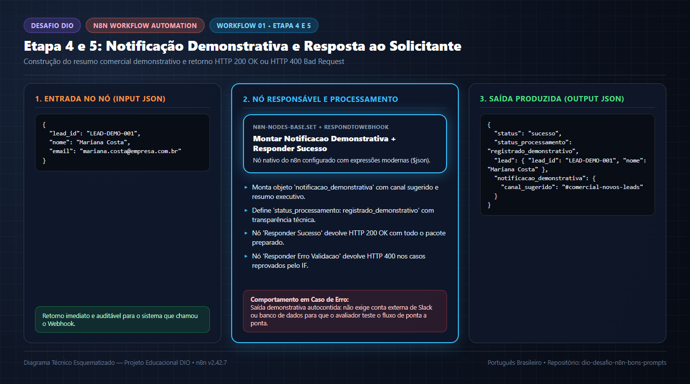
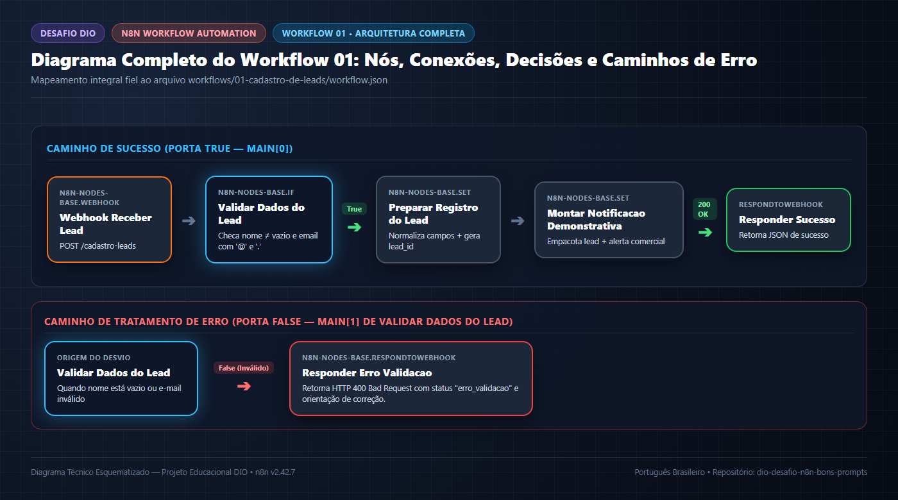

# 📋 Workflow 01 — Cadastro Automatizado de Leads

> **Navegação:** [⬅️ Todos os Workflows](../README.md) | [🏠 README Principal](../../README.md) | [🏆 Prompt Final DIO](../../prompts/prompt-final-desafio-dio.md) | [Próximo: Workflow 02 (Triagem IA) ➡️](../02-triagem-inteligente-ia/README.md)

---

## 1. Visão Geral e Objetivo

O **Workflow 01 — Cadastro Automatizado de Leads** materializa na prática o cenário planejado no [Prompt Final do Desafio DIO](../../prompts/prompt-final-desafio-dio.md).

Seu objetivo é substituir a conferência manual de cadastros vindos de formulários web por uma esteira automatizada no **n8n** que:
1. Recebe os dados do lead via requisição HTTP `POST` em um **Webhook**.
2. Valida imediatamente se os campos obrigatórios (`nome` e `email` em formato válido) estão presentes.
3. Higieniza e normaliza os campos (remoção de espaços extras, conversão de e-mail para minúsculas e preenchimento de valores padrão para campos opcionais).
4. Prepara o objeto estruturado de registro e a notificação comercial demonstrativa.
5. Retorna ao sistema chamador uma resposta HTTP síncrona (`200 OK` para sucesso ou `400 Bad Request` para dados inválidos).



> [!NOTE]
> **Transparência sobre Persistência Demonstrativa:** Para permitir que qualquer estudante ou avaliador importe e teste este workflow imediatamente sem precisar configurar bancos de dados externos ou contas pagas de CRM/Slack, a etapa final retorna os dados preparados e a notificação comercial como **saída demonstrativa** via `Respond to Webhook`. Não afirmamos que o lead foi gravado permanentemente em um banco externo não conectado.

### Diagrama Mermaid do Fluxo

> 📄 **Arquivo fonte:** [`assets/diagrams/fluxo-cadastro-leads.mmd`](../../assets/diagrams/fluxo-cadastro-leads.mmd)



---

## 2. Entrada dos Dados (`Webhook Receber Lead`)



- **O que acontece nesta etapa?**
  O workflow fica escutando chamadas HTTP `POST` no endpoint `/cadastro-leads` e recebe o pacote JSON enviado pelo formulário ou sistema de origem.
- **Qual nó é responsável?**
  `Webhook Receber Lead` (`n8n-nodes-base.webhook`, versão `2`), configurado com `httpMethod: "POST"`, `path: "cadastro-leads"` e `responseMode: "responseNode"`.
- **Quais dados entram?**
  Uma requisição HTTP `POST` cujo corpo (*body*) contém o JSON bruto enviado pelo cliente (veja [`exemplo-payload.json`](./exemplo-payload.json)):
  ```json
  {
    "nome": "  Mariana Costa  ",
    "email": "MARIANA.COSTA@empresa.com.br ",
    "telefone": "(11) 98765-4321",
    "empresa": "TechNova Soluções Digitais",
    "origem": "Landing Page Desafio DIO",
    "interesse": "Implantação de Automações com n8n e IA"
  }
  ```
- **Quais dados saem?**
  Um item n8n contendo `headers`, `params`, `query` e o objeto `body` com os campos recebidos, repassado para o nó de validação.
- **Por que essa etapa é necessária?**
  É o gatilho (*Trigger*) orientado a eventos que desacopla o site/formulário da lógica interna de automação, permitindo recepção em tempo real.
- **O que ocorre se houver erro?**
  Se o cliente chamar o endpoint com método diferente de `POST` (ex.: `GET`) ou enviar um corpo que não seja JSON válido, o próprio servidor HTTP do n8n rejeita a chamada antes de iniciar a execução do workflow.

---

## 3. Validação Condicional (`Validar Dados do Lead`)



- **O que acontece nesta etapa?**
  Os campos obrigatórios passam por uma checagem lógica estrita (*Fail-Fast*) com três condições combinadas pelo operador `AND`:
  1. `nome` (após `.trim()`) não está vazio (`notEmpty`).
  2. `email` (após `.trim()`) contém o símbolo `@`.
  3. `email` (após `.trim()`) contém pelo menos um ponto `.`.
- **Qual nó é responsável?**
  `Validar Dados do Lead` (`n8n-nodes-base.if`, versão `2.2`).
- **Quais dados entram?**
  O payload bruto vindo do `Webhook Receber Lead` (com suporte resiliente tanto a `$json.body.campo` quanto a `$json.campo`).
- **Quais dados saem?**
  O item original intacto, porém roteado para uma das duas portas de saída:
  - **Saída `main[0]` (`True`):** Quando todas as 3 condições são atendidas $\rightarrow$ segue para `Preparar Registro do Lead`.
  - **Saída `main[1]` (`False`):** Quando qualquer condição falha $\rightarrow$ desvia imediatamente para `Responder Erro Validacao`.
- **Por que essa etapa é necessária?**
  Impede que cadastros vazios, testes acidentais ou e-mails malformados poluam o pipeline ou acionem notificações indevidas para a equipe comercial.
- **O que ocorre se houver erro (dados inválidos)?**
  O fluxo interrompe o caminho normal e aciona o nó `Responder Erro Validacao`, devolvendo HTTP `400 Bad Request`.

---

## 4. Transformação e Preparação (`Preparar Registro do Lead`)



- **O que acontece nesta etapa?**
  Os dados aprovados na validação são higienizados, padronizados e enriquecidos com metadados de rastreabilidade.
- **Qual nó é responsável?**
  `Preparar Registro do Lead` (`n8n-nodes-base.set` / *Edit Fields*, versão `3.4`).
- **Quais dados entram?**
  O item validado vindo da porta `True` do nó `Validar Dados do Lead` (ex.: `"nome": "  Mariana Costa  "`, `"email": "MARIANA.COSTA@empresa.com.br "`).
- **Quais dados saem?**
  Um objeto JSON limpo e tipado:
  ```json
  {
    "lead_id": "LEAD-DEMO-001",
    "nome": "Mariana Costa",
    "email": "mariana.costa@empresa.com.br",
    "telefone": "(11) 98765-4321",
    "empresa": "TechNova Soluções Digitais",
    "origem": "Landing Page Desafio DIO",
    "interesse": "Implantação de Automações com n8n e IA",
    "processado_em": "2026-10-24T19:30:00.000Z"
  }
  ```
- **Por que essa etapa é necessária?**
  Sistemas de banco de dados e CRMs exigem consistência: e-mails em caixa baixa evitam duplicidades de chave e valores padrão evitam quebras por campos `null` / `undefined`.
- **O que ocorre se houver erro?**
  As expressões foram escritas com operadores de coalescência nula (`??`) e conversão explícita (`.toString().trim()`), garantindo que a ausência de campos opcionais (`telefone`, `empresa`, `origem`, `interesse`) nunca cause erro de execução.

---

## 5. Integrações Demonstrativas e Saídas (`Montar Notificacao Demonstrativa` + `Responder Sucesso`)



- **O que acontece nesta etapa?**
  O fluxo monta a estrutura de notificação comercial demonstrativa, agrupa os dados higienizados do lead e devolve a resposta final HTTP `200 OK` ao solicitante.
- **Quais nós são responsáveis?**
  1. `Montar Notificacao Demonstrativa` (`n8n-nodes-base.set`, versão `3.4`).
  2. `Responder Sucesso` (`n8n-nodes-base.respondToWebhook`, versão `1.1`, `responseCode: 200`).
- **Quais dados entram?**
  O objeto higienizado produzido por `Preparar Registro do Lead`.
- **Quais dados saem?**
  O contrato JSON final entregue na resposta HTTP `200 OK`:
  ```json
  {
    "status": "sucesso",
    "status_processamento": "registrado_demonstrativo",
    "observacao_persistencia": "Saída demonstrativa: os dados foram validados e higienizados com sucesso. Para persistência permanente, conecte um nó de banco de dados ou CRM após esta etapa.",
    "lead": {
      "lead_id": "LEAD-DEMO-001",
      "nome": "Mariana Costa",
      "email": "mariana.costa@empresa.com.br",
      "telefone": "(11) 98765-4321",
      "empresa": "TechNova Soluções Digitais",
      "origem": "Landing Page Desafio DIO",
      "interesse": "Implantação de Automações com n8n e IA",
      "processado_em": "2026-10-24T19:30:00.000Z"
    },
    "notificacao_demonstrativa": {
      "canal_sugerido": "#comercial-novos-leads",
      "assunto": "Novo Lead Qualificado: Mariana Costa",
      "mensagem": "Lead recebido de Landing Page Desafio DIO | Empresa: TechNova Soluções Digitais | E-mail: mariana.costa@empresa.com.br | Interesse: Implantação de Automações com n8n e IA"
    }
  }
  ```
- **Por que essa etapa é necessária?**
  Confirma para a aplicação cliente que o lead foi processado com sucesso e entrega o payload exato pronto para auditoria ou integração futura.
- **O que ocorre se houver erro?**
  Caso ocorra timeout de rede do cliente antes da resposta, a execução ainda fica registrada no histórico interno do n8n.

---

## 6. Tratamento de Erros (`Responder Erro Validacao`)

- **O que acontece nesta etapa?**
  Quando o nó `Validar Dados do Lead` detecta que `nome` está vazio ou que `email` não possui formato válido (`@` e `.`), o item é desviado pela saída `False` (`main[1]`) diretamente para este nó.
- **Qual nó é responsável?**
  `Responder Erro Validacao` (`n8n-nodes-base.respondToWebhook`, versão `1.1`, configurado com `responseCode: 400`).
- **Quais dados entram?**
  O payload inválido original recebido no Webhook.
- **Quais dados saem?**
  Uma resposta HTTP `400 Bad Request` estruturada em JSON:
  ```json
  {
    "status": "erro_validacao",
    "codigo_http": 400,
    "mensagem": "Payload inválido: os campos 'nome' (não vazio) e 'email' (em formato plausível contendo '@' e '.') são obrigatórios.",
    "dados_recebidos": {
      "nome": "João",
      "email": "email-invalido-sem-arroba"
    },
    "acao_recomendada": "Corrija os campos obrigatórios no corpo JSON da requisição e envie novamente."
  }
  ```
- **Por que essa etapa é necessária?**
  Fornece feedback semântico imediato para o frontend ou API chamadora corrigir os dados enviados, sem deixar a conexão HTTP pendurada.

---

## 7. Fluxo Final Consolidado e Como Testar



### Como Importar e Testar Passo a Passo
1. Importe o arquivo [`workflow.json`](./workflow.json) no seu n8n.
2. Clique em **Test workflow** no editor visual.
3. Envie o payload de exemplo ([`exemplo-payload.json`](./exemplo-payload.json)) via `curl` ou PowerShell:
   ```powershell
   Invoke-RestMethod -Uri "http://localhost:5678/webhook-test/cadastro-leads" -Method Post -ContentType "application/json" -InFile "workflows/01-cadastro-de-leads/exemplo-payload.json"
   ```
4. Para validar a estrutura do arquivo estaticamente sem precisar iniciar o servidor n8n, execute na raiz do projeto:
   ```powershell
   python tests/validar-workflows.py
   ```
