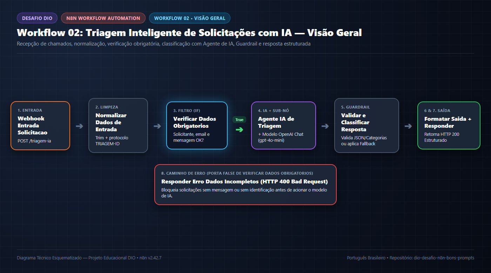
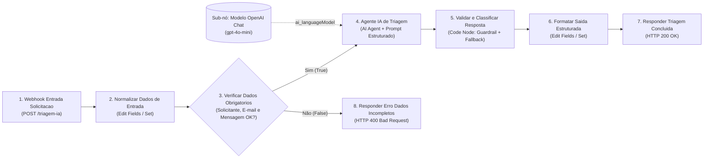
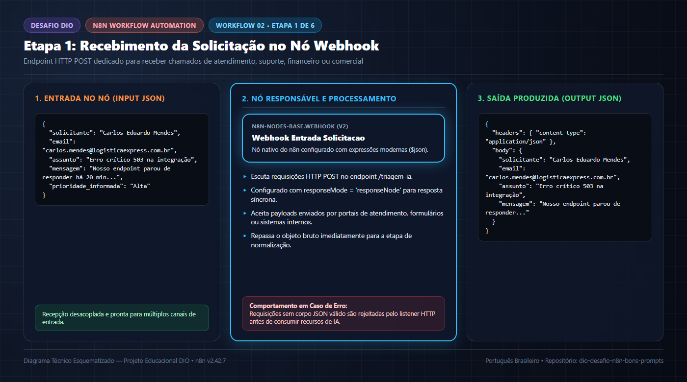
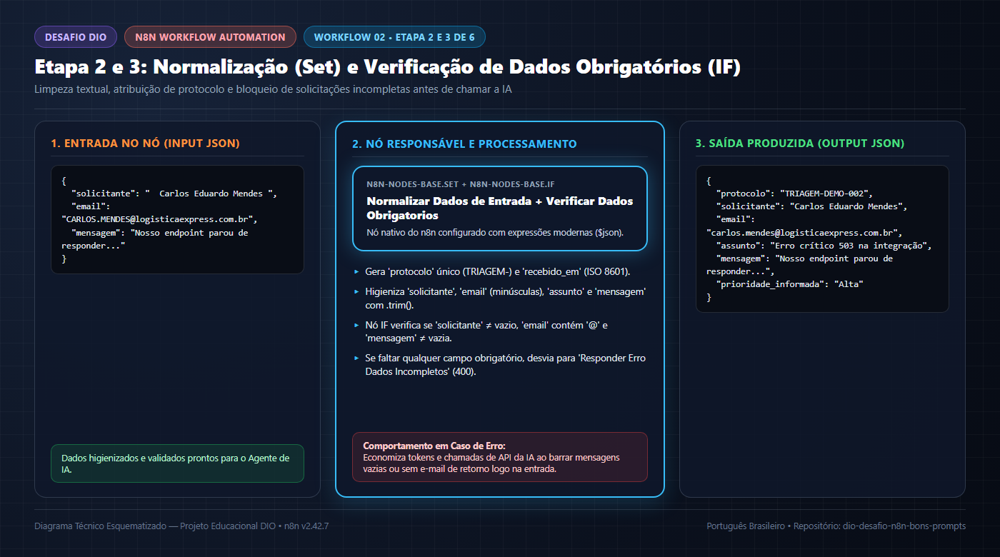
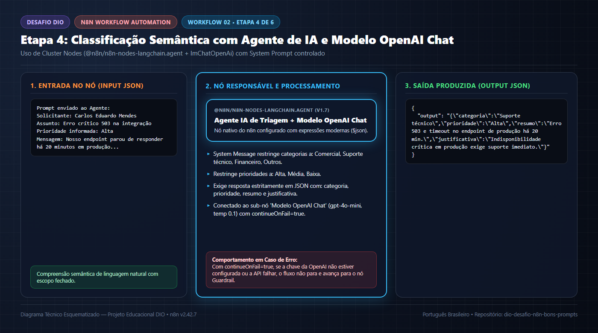
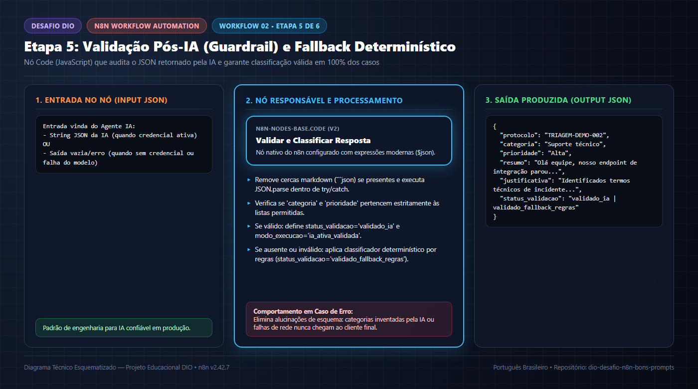
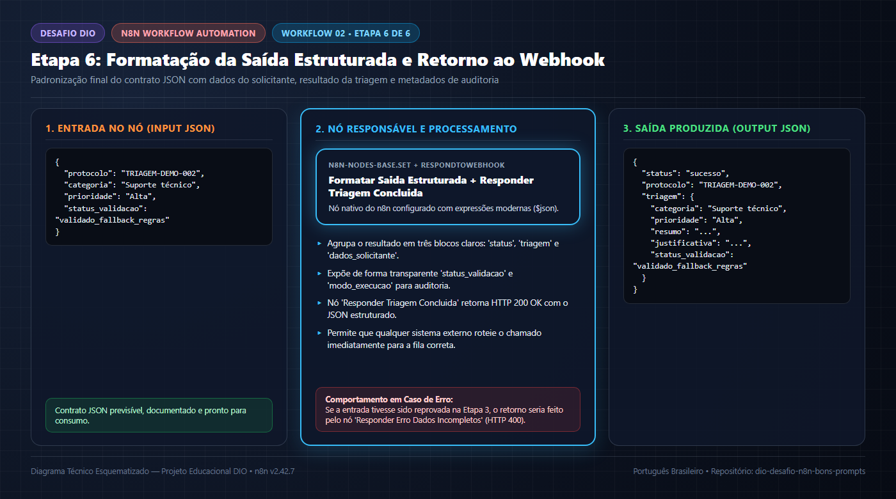

# 🤖 Workflow 02 — Triagem Inteligente de Solicitações com IA

> **Navegação:** [⬅️ Workflow 01 (Cadastro de Leads)](../01-cadastro-de-leads/README.md) | [⚙️ Todos os Workflows](../README.md) | [🏠 README Principal](../../README.md) | [🧪 Casos de Teste](../../tests/casos-de-teste.md)

---

## 1. Visão Geral e Objetivo

O **Workflow 02 — Triagem Inteligente de Solicitações com IA** demonstra como combinar **regras determinísticas de validação** com **Agentes de Inteligência Artificial Generativa** dentro do **n8n** para automatizar a classificação e priorização de mensagens de atendimento.

O fluxo recebe uma solicitação via Webhook, normaliza seus dados, verifica campos obrigatórios, aciona um **Agente de IA** (`@n8n/n8n-nodes-langchain.agent` conectado ao sub-nó `Modelo OpenAI Chat`), audita a resposta em um nó **Guardrail** (`Code Node`) e devolve um contrato JSON controlado com:
- **Categoria permitida:** `Comercial`, `Suporte técnico`, `Financeiro` ou `Outros`.
- **Prioridade permitida:** `Alta`, `Média` ou `Baixa`.
- **Resumo objetivo** e **Justificativa da decisão**.
- **Status de validação** (`validado_ia` ou `validado_fallback_regras`).



> [!IMPORTANT]
> **Modo Demonstrativo Sem Chave de API Externa:**  
> Em conformidade com as regras de segurança (nunca expor chaves de API em repositórios públicos), o arquivo [`workflow.json`](./workflow.json) **não contém tokens reais**. Caso você importe e execute o workflow com uma credencial `OpenAI API` configurada no seu n8n, o nó `Agente IA de Triagem` fará a inferência no modelo `gpt-4o-mini` (`modo_execucao: "ia_ativa_validada"`). Caso você execute **sem credencial configurada**, o fluxo **não falha**: o nó `Validar e Classificar Resposta` detecta a ausência de saída do LLM e aciona automaticamente o modo demonstrativo determinístico (`modo_execucao: "simulacao_demonstrativa_local"`), claramente identificado na resposta JSON.

### Diagrama Mermaid do Fluxo

> 📄 **Arquivo fonte:** [`assets/diagrams/fluxo-triagem-ia.mmd`](../../assets/diagrams/fluxo-triagem-ia.mmd)



---

## 2. Entrada dos Dados (`Webhook Entrada Solicitacao`)



- **O que acontece nesta etapa?**
  O workflow recebe via requisição HTTP `POST /triagem-ia` os dados brutos de uma solicitação de atendimento aberta por um cliente ou usuário.
- **Qual nó é responsável?**
  `Webhook Entrada Solicitacao` (`n8n-nodes-base.webhook`, versão `2`), configurado com `httpMethod: "POST"`, `path: "triagem-ia"` e `responseMode: "responseNode"`.
- **Quais dados entram?**
  Um payload JSON contendo `solicitante`, `email`, `assunto`, `mensagem` e `prioridade_informada` (veja [`exemplos/entrada-valida.json`](./exemplos/entrada-valida.json)):
  ```json
  {
    "solicitante": "Carlos Eduardo Mendes",
    "email": "carlos.mendes@logisticaexpress.com.br",
    "assunto": "Erro crítico 503 na integração do Webhook em produção",
    "mensagem": "Olá equipe, nosso endpoint de integração parou de responder há 20 minutos em ambiente de produção e está retornando erro de timeout e falha na API. Precisamos de suporte técnico urgente para restabelecer o fluxo.",
    "prioridade_informada": "Alta"
  }
  ```
- **Quais dados saem?**
  O pacote HTTP de entrada contendo `headers` e `body`, encaminhado para o nó de normalização.
- **Por que essa etapa é necessária?**
  Centraliza o recebimento de solicitações em um endpoint único padronizado.
- **O que ocorre se houver erro?**
  Chamadas sem JSON válido ou em método incorreto são recusadas na borda HTTP.

---

## 3. Normalização e Validação de Entrada (`Normalizar Dados de Entrada` + `Verificar Dados Obrigatorios`)



- **O que acontece nesta etapa?**
  Primeiro, os campos recebidos são limpos (`.trim()`), o e-mail é convertido para minúsculas, um código de `protocolo` (`TRIAGEM-<id>`) é gerado e valores opcionais recebem texto padrão se ausentes. Em seguida, o nó condicional verifica se `solicitante` não está vazio, se `email` contém `@` e se `mensagem` não está vazia.
- **Quais nós são responsáveis?**
  1. `Normalizar Dados de Entrada` (`n8n-nodes-base.set`, versão `3.4`).
  2. `Verificar Dados Obrigatorios` (`n8n-nodes-base.if`, versão `2.2`).
- **Quais dados entram?**
  O JSON bruto recebido no Webhook.
- **Quais dados saem?**
  - **Na porta `True` (`main[0]`):** O objeto normalizado completo segue para o `Agente IA de Triagem`.
  - **Na porta `False` (`main[1]`):** Quando falta solicitante, e-mail válido ou mensagem (como em [`exemplos/entrada-incompleta.json`](./exemplos/entrada-incompleta.json)), o fluxo desvia para `Responder Erro Dados Incompletos`.
- **Por que essa etapa é necessária?**
  Evita desperdício financeiro e computacional: nunca devemos acionar um Modelo de Linguagem (LLM) se a mensagem estiver vazia ou se os dados básicos de contato forem inválidos.
- **O que ocorre se houver erro (dados incompletos)?**
  O fluxo retorna imediatamente HTTP `400 Bad Request` informando quais campos obrigatórios faltaram.

---

## 4. Processamento Cognitivo (`Agente IA de Triagem` + `Modelo OpenAI Chat`)



- **O que acontece nesta etapa?**
  O Agente de IA analisa o `assunto`, a `mensagem` e a `prioridade_informada` seguindo uma instrução de sistema (*System Message*) rigorosa para classificar a demanda e devolver um objeto JSON contendo `categoria`, `prioridade`, `resumo` e `justificativa`.
- **Quais nós são responsáveis?**
  1. **Nó Raiz:** `Agente IA de Triagem` (`@n8n/n8n-nodes-langchain.agent`, versão `1.7`), configurado com `continueOnFail: true`.
  2. **Sub-nó de Modelo:** `Modelo OpenAI Chat` (`@n8n/n8n-nodes-langchain.lmChatOpenAi`, versão `1.2`), conectado via porta `ai_languageModel` com modelo `gpt-4o-mini` e `temperature: 0.1`.
- **Quais dados entram?**
  Os campos normalizados (`solicitante`, `assunto`, `prioridade_informada`, `mensagem`) interpolados no prompt do agente.
- **Quais dados saem?**
  Um item contendo a propriedade `output` com a string JSON gerada pelo modelo (ou o objeto de erro capturado caso não haja credencial configurada).
- **Por que essa etapa é necessária?**
  Permite interpretar linguagem natural aberta, resumir relatos longos de clientes e discernir a intenção principal da mensagem.
- **O que ocorre se houver erro?**
  Graças à configuração `continueOnFail: true`, se a API externa estiver indisponível, se a cota acabar ou se o usuário estiver testando sem credencial da OpenAI, o workflow **não interrompe a execução** e entrega o controle para o nó de *Guardrail* seguinte.

---

## 5. Validação da Resposta e Guardrail (`Validar e Classificar Resposta`)



- **O que acontece nesta etapa?**
  O código JavaScript audita a resposta vinda do `Agente IA de Triagem`:
  1. Remove eventuais marcações markdown (`` ```json ``) e executa `JSON.parse()` protegido por `try/catch`.
  2. Confirma se `categoria` pertence estritamente a `["Comercial", "Suporte técnico", "Financeiro", "Outros"]` e se `prioridade` pertence estritamente a `["Alta", "Média", "Baixa"]`.
  3. Se a saída da IA for válida, preserva a classificação com `status_validacao: "validado_ia"` e `modo_execucao: "ia_ativa_validada"`.
  4. Caso a IA não tenha respondido (ex.: execução local sem credencial) ou tenha retornado formato fora do esquema, aplica o classificador determinístico de contingência com `status_validacao: "validado_fallback_regras"` e `modo_execucao: "simulacao_demonstrativa_local"`.
- **Qual nó é responsável?**
  `Validar e Classificar Resposta` (`n8n-nodes-base.code`, versão `2`).
- **Quais dados entram?**
  A saída do `Agente IA de Triagem` combinada aos dados originais de `$('Normalizar Dados de Entrada').item.json`.
- **Quais dados saem?**
  Um objeto 100% garantido dentro do contrato de domínio esperado pela aplicação.
- **Por que essa etapa é necessária?**
  Modelos de linguagem são probabilísticos e podem alucinar chaves ou categorias não previstas. O nó de *Guardrail* garante determinismo e confiabilidade de engenharia.
- **O que ocorre se houver erro na saída da IA?**
  O bloco `catch` captura qualquer erro de parsing JSON e aciona o fallback determinístico sem interromper o fluxo.

---

## 6. Saída Estruturada e Tratamento de Erros (`Formatar Saida Estruturada`, `Responder Triagem Concluida` e `Responder Erro Dados Incompletos`)



- **O que acontece nesta etapa?**
  O resultado validado é organizado no envelope final (`status`, `protocolo`, `triagem` e `dados_solicitante`) e retornado com código HTTP `200 OK` pelo nó `Responder Triagem Concluida`. Já solicitações reprovadas na etapa 3 recebem HTTP `400 Bad Request` pelo nó `Responder Erro Dados Incompletos`.
- **Quais nós são responsáveis?**
  1. `Formatar Saida Estruturada` (`n8n-nodes-base.set`, versão `3.4`).
  2. `Responder Triagem Concluida` (`n8n-nodes-base.respondToWebhook`, versão `1.1`, HTTP `200`).
  3. `Responder Erro Dados Incompletos` (`n8n-nodes-base.respondToWebhook`, versão `1.1`, HTTP `400`).
- **Quais dados saem (Exemplo para `entrada-valida.json` — HTTP 200):**
  ```json
  {
    "status": "sucesso",
    "protocolo": "TRIAGEM-DEMO-002",
    "triagem": {
      "categoria": "Suporte técnico",
      "prioridade": "Alta",
      "resumo": "Olá equipe, nosso endpoint de integração parou de responder há 20 minutos em ambiente de produção e está retornando erro de timeout e...",
      "justificativa": "Identificados termos técnicos de incidente ou falha operacional que requerem atuação da equipe de suporte.",
      "status_validacao": "validado_fallback_regras",
      "modo_execucao": "simulacao_demonstrativa_local"
    },
    "dados_solicitante": {
      "solicitante": "Carlos Eduardo Mendes",
      "email": "carlos.mendes@logisticaexpress.com.br",
      "assunto": "Erro crítico 503 na integração do Webhook em produção",
      "processado_em": "2026-10-24T19:35:00.000Z"
    }
  }
  ```

---

## 7. Fluxo Completo e Exemplos de Teste Disponíveis


Na subpasta [`exemplos/`](./exemplos/), disponibilizamos **três payloads JSON** prontos para testar todos os caminhos do workflow:

| Arquivo de Exemplo | Cenário Testado | Resultado Esperado |
| :--- | :--- | :--- |
| [`exemplos/entrada-valida.json`](./exemplos/entrada-valida.json) | Solicitação completa relatando erro crítico 503 em produção. | `HTTP 200 OK` $\rightarrow$ `categoria: "Suporte técnico"`, `prioridade: "Alta"`. |
| [`exemplos/entrada-incompleta.json`](./exemplos/entrada-incompleta.json) | Solicitação com e-mail sem `@` e mensagem vazia. | `HTTP 400 Bad Request` via `Responder Erro Dados Incompletos`. |
| [`exemplos/entrada-fora-do-escopo.json`](./exemplos/entrada-fora-do-escopo.json) | Convite para feira gastronômica (não corresponde a Comercial, Suporte ou Financeiro). | `HTTP 200 OK` $\rightarrow$ `categoria: "Outros"`, `prioridade: "Baixa"`. |
